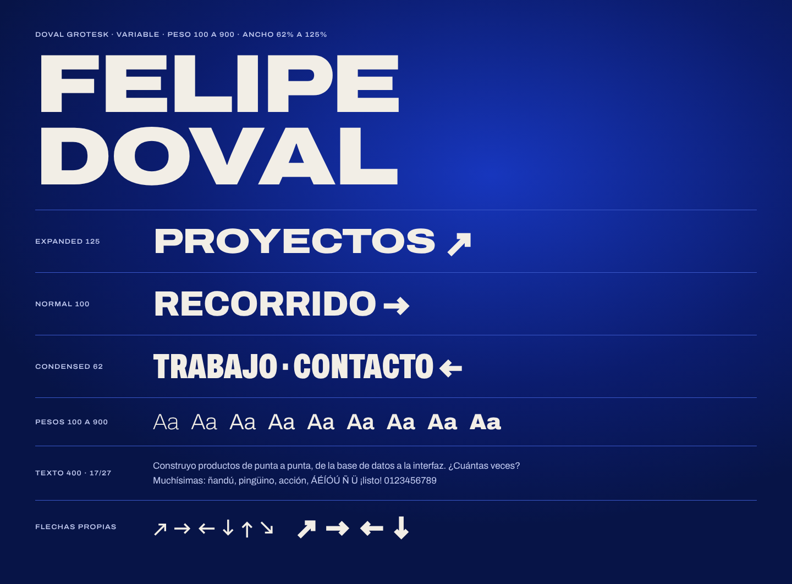

# Tipografía: Doval Grotesk

**La única fuente del sitio** (desde la v7). Una grotesca variable en dos
ejes: **peso** (100 a 900) y **ancho** (62% a 125%). Extendida y negra hace de
logo y de títulos; en ancho normal hace de texto de lectura. Una sola familia,
cero fuentes de reemplazo.



## Archivos

| Archivo | Para qué |
|---|---|
| `doval-grotesk/DovalGrotesk.ttf` | **Instalar en la Mac** (doble clic → Instalar). Figma la toma sola: aparece como *Doval Grotesk* con 54 estilos (de *ExtraCondensed Thin* a *Expanded Black*) y el ancho también se puede mover en el panel de ejes variables. |
| `doval-grotesk/DovalGrotesk.woff2` | La misma, comprimida para la web (copia en `app/fonts/`). |
| `doval-grotesk/LICENSE-Archivo-OFL.txt` | Licencia de la fuente base (SIL OFL 1.1). Viaja siempre con la fuente. |
| `doval-grotesk/construir.py` | Cómo se arma (ver abajo). |
| `doval-grotesk/especimen.png` | Muestra: anchos, pesos, texto y flechas. |
| `doval-script/` | La script de cartel de la v6 (derivada de Norican). **Ya no se usa en el sitio.** |

## Por qué esta y no otra: el análisis

Felipe pasó cinco referencias: **Tahoe**, **Inner** (la del afiche "URGENT"),
**Reatro Retro** (Pandeka), **Viltrum** (Super Bold Condensed, Pekotype) y
**Drupadi**. La consigna: elegir la mejor para el sitio (o mezclar e inventar
una), replicarla y que sea **la única fuente**. Eso último decide casi todo,
porque la misma letra tiene que funcionar a 150 px en un título y a 12,5 px en
una etiqueta.

### Los criterios, en orden de peso

1. **Que aguante texto corrido.** Si es la única fuente, la bio, los casos y
   los botones van en ella. Una fuente sólo-display queda descartada.
2. **Que conviva con la gota de vidrio.** La gota refracta las letras que
   tiene detrás, las aumenta y las dobla. Eso se lee bien en formas grandes,
   macizas y de contraformas abiertas; en letras finas, con cortes o ya
   deformadas, la refracción y el dibujo se pelean y queda ruido.
3. **Profesional, no infantil.** Es el feedback que mató a la v6.
4. **Que no parezca IA.** Ni la grotesca neutra de siempre (la que tiene
   cualquier template) ni el "futurista tech" que hoy grita cripto y gaming.
5. **Español completo:** tildes, ñ, ü, ¿ y ¡.
6. **Licencia limpia.** Las cinco son comerciales: no se puede copiar el
   archivo ni calcar los contornos. "Replicarla" es reproducir el género y el
   carácter, no el dibujo exacto.

### Las cinco, una por una

| Fuente | Qué es | Contra el sitio |
|---|---|---|
| **Tahoe** | Grotesca **extendida** y negra: letras anchas, terminales rectos, contraformas horizontales y apretadas, la O como un óvalo ancho, la A de ápice casi plano. Tono de afiche suizo o de marca deportiva: seguro, institucional, adulto. | La única que suma en todos los criterios. Sola es display, pero el género tiene familias con eje de ancho (la misma letra, angosta, sirve para leer). Con el vidrio es ideal: trazos gruesos y anchos que la gota aumenta sin romper. |
| **Inner** | Unicase geométrica tipo stencil, con cortes en casi todas las letras. | El propio afiche lo muestra: el párrafo en esa letra cuesta. Mayúscula y minúscula iguales (se pierden los nombres propios). Los cortes compiten con la refracción: dos efectos peleando en el mismo lugar. |
| **Reatro Retro** | Display ondulada de los 70, lúdica. | Es exactamente lo que el feedback llamó infantil. Y una letra que ya viene deformada no deja ver la deformación de la gota. Ilegible como texto. |
| **Viltrum** | Condensada súper negra, muy alta. | Potente en afiche, imposible en párrafo. En 1440 px un título condensado ocupa media pantalla y deja aire muerto; la gota sobre trazos verticales apretados se ve como rayas. |
| **Drupadi** | "Futuristic font": geométrica fina con cortes. | El género que más delata IA y crypto. El trazo fino, aumentado por la gota, se vuelve hilos. Baja legibilidad en chico. |

### La decisión: Tahoe, con un poco de Viltrum adentro

**Tahoe** marca la dirección. Para que sea la única fuente hacía falta una
grotesca del mismo género **con eje de ancho**: así el extremo extendido y
negro es el "Tahoe" de los títulos, el ancho normal es el texto, y el extremo
condensado (62%) es el "Viltrum" de la misma familia, disponible sin sumar
otra fuente. En el sitio el ancho se usa como recurso responsive: los títulos
van al 125% en desktop y bajan al 100% en el celular, **mismo tamaño, menos
ancho**, y "Recorrido" entra entero sin achicarse.

La base es **Archivo**, de **Omnibus-Type** (fundidora argentina), bajo SIL
OFL 1.1 y sin Reserved Font Name. A 900/125 coincide con Tahoe rasgo por
rasgo: ancho de caja, terminales horizontales, O ovalada ancha, contraformas
apretadas y peso. No es un calco de Tahoe: es la misma familia de ideas, en una
fuente que se puede modificar y distribuir.

### Qué tiene de propio Doval Grotesk

- **Flechas dibujadas para ella** (↗ → ← ↓ ↑ ↘), que el sitio usa en botones y
  listas. Archivo no las trae, y sin ellas el navegador las sacaba de otra
  fuente (rompía la regla de una sola letra). Son variables: engordan con el
  peso y se ensanchan con el ancho, como el resto de los glifos.
- **54 estilos con nombre** para Figma y la Mac (seis anchos por nueve pesos).
- Renombrada (*Doval Grotesk*), recortada a latín (español completo) y con los
  metadatos de licencia y autoría en orden.

### El sistema de uso (sitio y Figma)

| Rol | Peso / ancho | Tamaño |
|---|---|---|
| Nombre (hero) | 900 / 125, mayúsculas, −2,5% | min(11,6vw, 21vh) |
| Título de sección | 850 / 125, mayúsculas | clamp(56, 9,4vw, 150); en el celular 14,4vw al 100% |
| Nombre de un caso | 850 / 125 | clamp(48, 7vw, 112) |
| Subtítulo (H3) | 700 / 112 | 22 a 40 |
| Lead | 430 / 100 | 21 / 29 |
| Cuerpo | 400 / 100 | 17 / 27 |
| Etiqueta | 560 / 112, mayúsculas, +8% | 12,5 |

En los frames de Figma (página *Diseño v7*) el texto editable usa **Archivo**,
que Figma ya tiene y tiene los mismos contornos; los títulos extendidos van en
contornos vectoriales para conservar el ancho. Con Doval Grotesk instalada se
pueden pasar a texto con la fuente propia.

## Cómo se arma

```bash
# la base: Archivo variable (peso + ancho), subset latín, de Fontsource
npm pack @fontsource-variable/archivo && tar xzf fontsource-variable-archivo-*.tgz
python3 construir.py package/files/archivo-latin-wdth-normal.woff2 DovalGrotesk
cp DovalGrotesk.woff2 ../../../app/fonts/
```

Requiere `fonttools` y `brotli` (`pip install fonttools brotli`).
