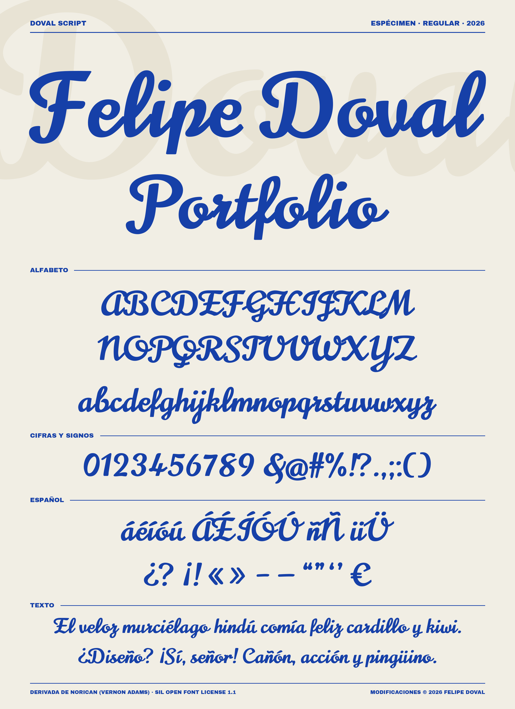

# Doval Script

> **Retirada del sitio en la v7** (el sitio usa una sola fuente, Doval Grotesk:
> ver `../LEEME.md`). Queda acá para piezas de marca y por si Felipe la quiere
> usar en Figma.

Tipografía script de cartel retro (pintor de letras de los 50/60) para la marca de
Felipe Doval: trazo pesado, terminaciones redondeadas, inclinación moderada (~10–12°)
y letras que se conectan entre sí. Pensada para títulos y piezas de marca (en el
sitio: tinta verde botella `#0F3D2E` con sombra dura lima `#78D561`); de 1 a 3
palabras, no para texto corrido. El espécimen está en el azul del screenshot de
referencia.



## Archivos

| Archivo | Para qué |
|---|---|
| `DovalScript-Regular.otf` | Instalar en la Mac (Figma, Illustrator, Keynote…). Contornos CFF. |
| `DovalScript-Regular.ttf` | Lo mismo en TrueType, por si alguna app prefiere TTF. |
| `DovalScript.woff2` | Versión web (comprimida). Desde la v7 el sitio ya no la usa. |
| `LICENSE-Norican.txt` | Licencia de la fuente original (SIL OFL 1.1). Viaja siempre con la fuente. |
| `especimen.png` | Muestra con alfabeto, cifras y caracteres del español. |

Cobertura: latín básico completo, todo lo del español (á é í ó ú Á É Í Ó Ú ñ Ñ ü Ü
¿ ¡ « » – — “ ” ‘ ’ €) y el resto de Latin-1/Latin Extended-A que ya traía la base.

## De dónde sale

Es una **versión modificada de [Norican](https://github.com/googlefonts/NoricanFont)**,
de Vernon Adams, publicada bajo la **SIL Open Font License 1.1**
(Copyright 2011 The Norican Project Authors). La licencia de Norican **no tiene
"Reserved Font Name"**, así que el derivado podría usar cualquier nombre; igual se
le puso uno nuevo (Doval Script) para no confundirla con la original.

Se eligió Norican después de comparar 21 familias script libres de Google Fonts (Yellowtail,
Damion, Oleo Script, Leckerli One, Playball, Grand Hotel, Kaushan, Lily Script One,
Pacifico, Lobster, Yesteryear, Cookie, Style Script, etc.) contra la referencia:
es la que tiene el esqueleto más parecido (r de panza, s y c con remate de bola,
mayúsculas con lazo, uniones bajas) y no es un cliché tan gastado como Pacifico o
Lobster.

## Qué se le cambió a Norican

Medidas en unidades de fuente (2048 por eme):

1. **Más peso.** Se engordó el contorno 32 u. en horizontal y 18 u. en vertical por
   lado (offset redondo sobre el contorno, en forma anisotrópica para engordar más
   las astas que los trazos finos y conservar el contraste). Las astas pasan de
   ~200 a ~265 u. (+32 %). Las contraformas de a, e, o, s, g siguen abiertas.
2. **Más derecha.** Se enderezó 4° (de ~15° a ~10–12° de inclinación), pivotando a la
   altura de las uniones para que las letras sigan conectando en el mismo lugar.
3. **Espaciado y kerning intactos.** Cada glifo ganó 64 u. de avance y se corrió
   32 u., así los márgenes laterales y el kerning original siguen valiendo y las
   uniones entre minúsculas quedan sin cortes. El espacio entre palabras pasó de
   389 a 469 u. porque con el trazo más pesado quedaba apretado.
4. **Acentos.** Los acentos superiores se subieron 27 u. para que no se peguen a la
   letra más gruesa; se ajustaron las anclas de posicionamiento (`mark`/`mkmk`) y
   los carets de ligaduras.
5. **Remates de palabra activados por defecto.** Norican trae formas finales
   (`a e n o s t u y…`) que casi ninguna app usa. Ahora una regla `calt`
   (alternativas contextuales, activas por defecto en Figma, macOS y navegadores)
   las pone solas al final de cada palabra, y las U V W con entrada larga al
   comienzo. Se agregaron **53 finales acentuadas** (á é ó ú ñ ü…) para que
   "está", "café" o "diseñó" también terminen con remate.
6. **Sin hinting** (el original ya no servía con los contornos nuevos); queda solo
   la instrucción mínima de control de *dropout* que se recomienda para fuentes
   sin hinting.
7. **Nombres nuevos:** familia "Doval Script", estilo "Regular", PostScript
   `DovalScript-Regular`. Copyright: se mantiene el original y se agrega
   "Modifications © 2026 Felipe Doval".

## Instalar en macOS (para Figma)

1. Doble clic en `DovalScript-Regular.otf` → se abre **Catálogo Tipográfico**
   (Font Book) → **Instalar**. Instalá **solo uno** de los dos archivos (OTF o TTF),
   no los dos, para no tener la familia duplicada.
2. **Figma de escritorio:** cerrala del todo (⌘Q) y volvé a abrirla. Aparece como
   "Doval Script".
3. **Figma en el navegador:** necesita el instalador de fuentes de Figma
   (*Figma font installer*, se baja desde figma.com/downloads). Con eso instalado,
   recargá la pestaña.

Para usarla en el sitio, la versión web es `app/fonts/DovalScript.woff2`; se carga
igual que las otras locales de `lib/fonts.ts` (`next/font/local`), por ejemplo:

```ts
export const fontScript = localFont({
  src: "../app/fonts/DovalScript.woff2",
  variable: "--font-script",
  display: "swap",
  fallback: ["cursive"],
});
```

## Licencia (resumen, no reemplaza al texto)

SIL OFL 1.1: se puede usar gratis en cualquier proyecto (personal o comercial),
incrustar en PDFs y webs, modificar y redistribuir, siempre que la fuente se
distribuya con `LICENSE-Norican.txt` y los derivados sigan bajo OFL. Lo único que
no se puede es **vender la fuente sola**.

## Sobre "Artisan Script" (la referencia)

El look de referencia es **Artisan Script**, de **HRDR** (Creative Market). Es una
fuente **comercial**: la licencia desktop ronda los **USD 19** y el uso en web
necesita su propia licencia aparte. Doval Script **no es una copia ni un calco**
de ella: no usa ningún dibujo de Artisan Script, es un derivado de Norican llevado
hacia un aire parecido. Si algún día se quiere la original exacta, hay que
comprarla con la licencia que corresponda al uso (desktop y/o web).
